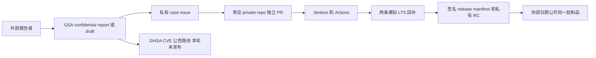
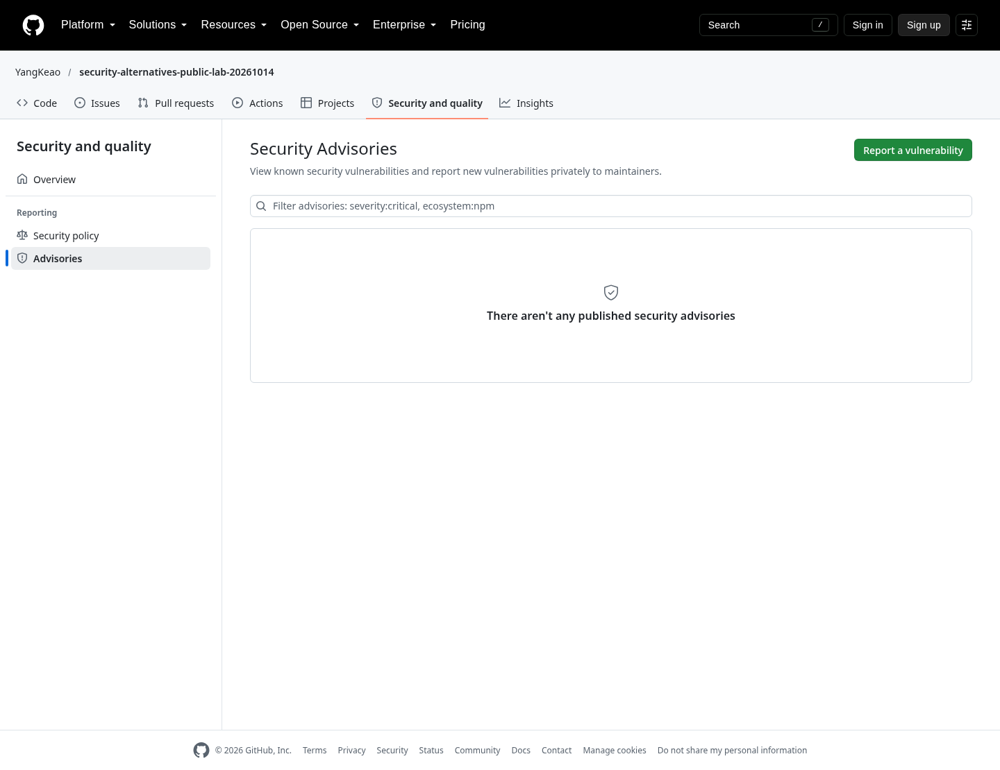

# 方法一 GSA 与常设私有工作区混合流程

## 结论与体验

这条路线最接近 TiDB 现有 GitHub 生态：GSA 继续负责外部报告和 advisory，普通 private repo 承载修复、完整 CI 和多版本集成。
GSA temporary fork 不再是所有代码和发布工作的必经工作区。

本次不是只画方案：创建了两个新的 GSA draft，并实际关联已在私有工作区修复和验证的两个合成 case。
为了复用相同测试基线，实验先完成合成代码修复，再验证两条 draft 的接线。
生产应先 intake/triage，再开发，不应照搬这个实验执行顺序。

## 实验对象

| case | draft | 私有 issue | 私有修复 |
|---|---|---|---|
| LAB-A | GHSA-pjwp-c2g7-4xhc | #1 | PR #2，commit `149592432e3e6d36f02234b7c8b454f200627268` |
| LAB-B | GHSA-2652-9xcx-9vg4 | #3 | PR #4，commit `3194b28e5444d8c407674c9b4e5dd57899296d78` |

- [draft A](https://github.com/YangKeao/security-alternatives-public-lab-20261014/security/advisories/GHSA-pjwp-c2g7-4xhc)
- [draft B](https://github.com/YangKeao/security-alternatives-public-lab-20261014/security/advisories/GHSA-2652-9xcx-9vg4)
- [修复 A](https://github.com/YangKeao/security-embargo-private-lab-20261014/pull/2)
- [修复 B](https://github.com/YangKeao/security-embargo-private-lab-20261014/pull/4)

两个 draft 的 severity 都为 low，内容明确 SYNTHETIC，不声明真实受影响产品。
它们都保持 draft，`cve_id`/`published_at` 没有被设置为真实发布结果。
没有调用 CVE 请求或 advisory publish。

## 数据如何流动



case 记录、代码提交、支持分支和 release bundle 是不同对象。
本轮 private issue 随修复 PR 关闭，仅代表代码里程碑；对应 GSA 仍为 draft，不代表已披露。
一个 release bundle 可以包含两个 case；一个 case 也可跨多个 release line。
不要把一条 branch 当作全部状态的唯一来源。

## 操作一 启用公开仓库的报告入口

浏览器点击：

1. 打开公开实验仓库。
2. 进入 Settings。
3. 找到 Security / Code security 的 Private vulnerability reporting。
4. 启用报告入口。
5. 打开 Security → Advisories，检查 Report a vulnerability 入口。

本轮执行的 API：

```bash
gh api --method PUT \
  repos/YangKeao/security-alternatives-public-lab-20261014/private-vulnerability-reporting
```



公开入口的存在不等于报告内容公开。
当前维护者账号不能用 reporter API 冒充另一个外部报告者；这个限制在前一轮 GSA lab 已实际验证。
本轮没有注册第二个人类 GitHub 账号或伪造外部报告。

## 操作二 维护者创建两个独立 draft

浏览器点击：

1. 公开仓库 → Security → Advisories。
2. 选择创建新的 repository security advisory 草稿。
3. 填写 summary、description、severity 和影响范围。
4. 对每个可独立修复的问题分别建 draft。
5. 暂不点击 Request CVE 或 Publish。

创建脚本为 [`github_hybrid.py`](../scripts/github_hybrid.py)。
核心请求形式：

```bash
gh api --method POST \
  repos/YangKeao/security-alternatives-public-lab-20261014/security-advisories \
  --input synthetic-advisory.json
```

合成案例请求体：

```json
{
  "summary": "[SYNTHETIC] LAB-A hybrid workflow demonstration",
  "description": "Impact / Patches / Workarounds / References 中明确说明是合成实验",
  "severity": "low",
  "vulnerabilities": []
}
```

真实案例必须填写真实的影响/修复版本和适用生态；空列表仅用于这个无产品的合成实验。
精确请求和返回对象在 [hybrid 回执](../evidence/github-hybrid-receipts.json)。

## 操作三 转入常设私有工作区

1. 在普通 private repo 中建立 case issue。
2. 记录 advisory URL、协调人、影响版本、预定披露时间和验证要求。
3. 为 LAB-A 和 LAB-B 各建独立 fix branch 和 PR。
4. 使用 PR commit SHA 触发 CI，而不是只跟踪可变 branch 名。
5. review/fix/CI 完成后逐 PR 合并。
6. 将 canonical commit 和验证结果回写 case 记录。

本轮 issue #1/#3 留下了对应 GHSA 的关联 comment。

```bash
gh api --method POST \
  repos/YangKeao/security-embargo-private-lab-20261014/issues/1/comments \
  --input synthetic-case-link.json
```

外部报告者获得 GSA collaborator 权限，不会自动得到另一个 private repo 的权限。
生产应明确哪些人只看报告、哪些人看代码、哪些人能看 RC；不能用一个 URL 代替权限交接。
本轮只实测维护者账号和匿名访问，没有实测第二个 GitHub collaborator 的邀请/撤销。

## 操作四 多漏洞整合与回补

两个普通私有 PR 已分别合并，两个 LTS 回补 PR 则同时保持可检查状态。

- main：合成 A 和 B 均已进入私有集成主线。
- release/8.5：两次 cherry-pick 都干净，完整回归通过。
- release/8.1：A 的 cherry-pick 发生真实 conflict，人工调整后继续；B 干净。
- 私有 PR #6/#7 分别以两个 release 分支为 base，正常创建。

这与 GSA 临时 fork 的非 main base 请求限制不同。
完整回补操作见[方法二](02-private-embargo-repo.zh-CN.md)。

## 操作五 公告和发布的分工

真实协调披露日应同时处理：

1. 公开已审阅的源代码提交和受支持版本 tag。
2. promote 已测试的同一批制品。
3. 发布各 case 的 advisory/CVE 和 affected/fixed version 信息。
4. 更新升级与缓解指南。

本轮只公开了 SYNTHETIC 模拟制品，两个 GSA draft 没有发布。
不能把这里的“公开 promotion 成功”误解为曾申请或发布真实 CVE。
GSA 的真实 CVE、publish、外部 reporter triage 操作仍参考[前一轮完整报告](https://github.com/YangKeao/gsa-ci-integration-lab-20261012)。

## 体验优点与成本

优点：保留熟悉的外部入口；代码/CI 不受临时 fork 限制；多漏洞可以独立审阅后组合验证。
成本：两个工作区的权限、case 状态和链接需要同步，必须指定协调人。
若没有明确的状态交接，容易出现“GSA 已标完成但某条 LTS 未就绪”或“私有 PR 已合并但公告版本不完整”。
推荐让一份 release manifest 记录所有 canonical SHA、LTS PR、CI 结果和制品 digest。

## 可验证结论和权限边界

- 实测：两条 draft、两个普通私有 case、独立 merge、两条 LTS、真实 Jenkins/status。
- 实测：匿名访问私有 repo 和私有 Release asset 返回 404。
- 当前账户限制：private branch protection 要求 Pro，不具备强制门禁。
- 未实测：多人私有团队权限、GitHub App 安装和 TiDB 生产 Jenkins 授权。

## 官方资料

- [GitHub 在临时私有 fork 中协作](https://docs.github.com/en/code-security/tutorials/fix-reported-vulnerabilities/collaborate-in-a-fork)
- [GitHub 发布 repository advisory](https://docs.github.com/en/code-security/how-tos/report-and-fix-vulnerabilities/fix-reported-vulnerabilities/publish-repository-advisory)
- [普通仓库镜像复制](https://docs.github.com/en/repositories/creating-and-managing-repositories/duplicating-a-repository)
