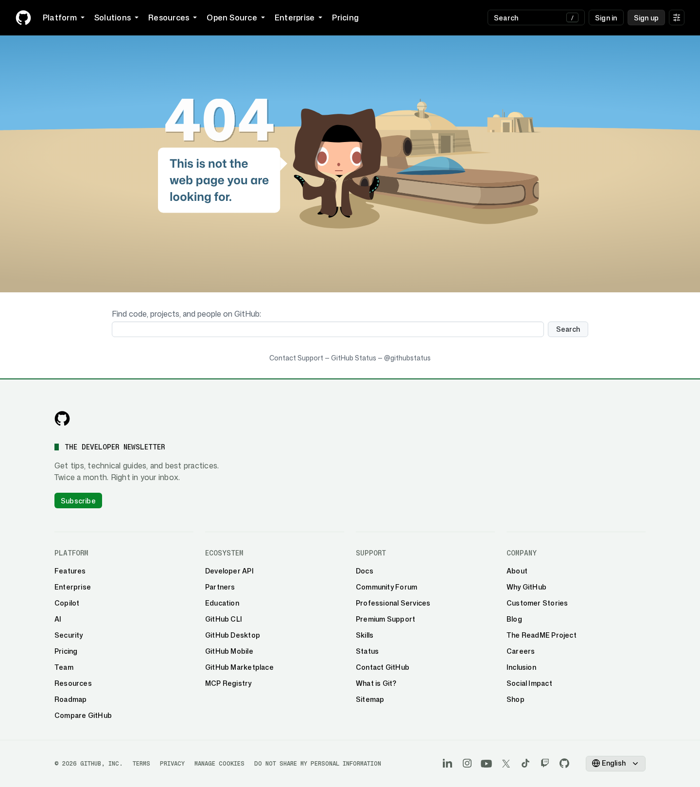
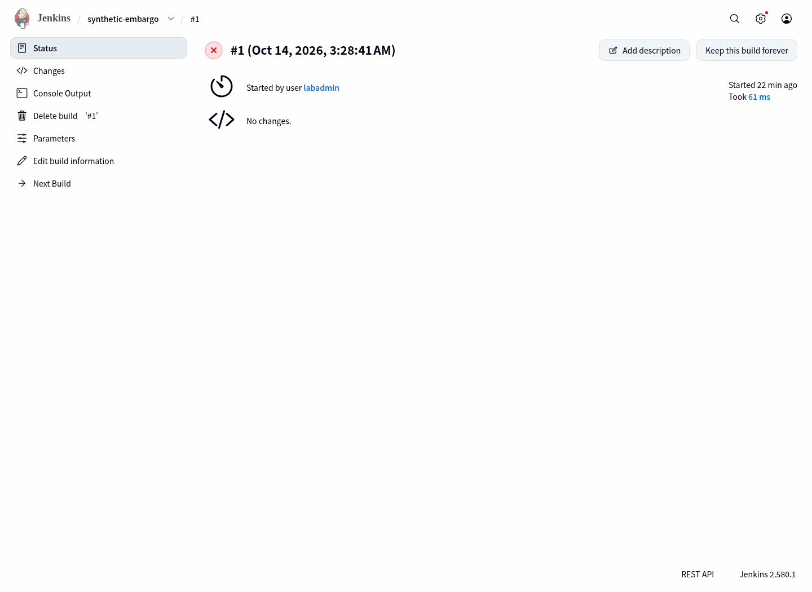
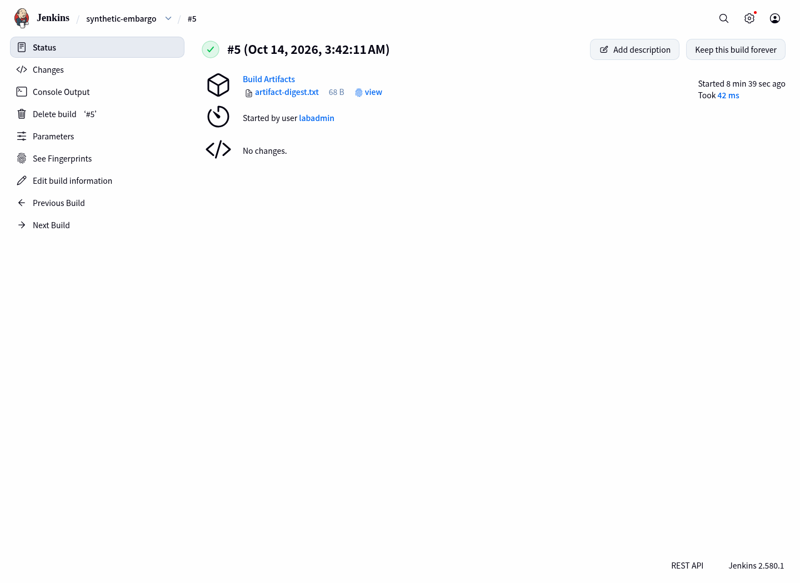
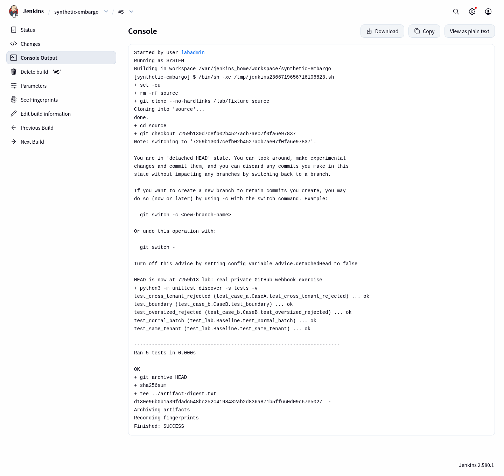
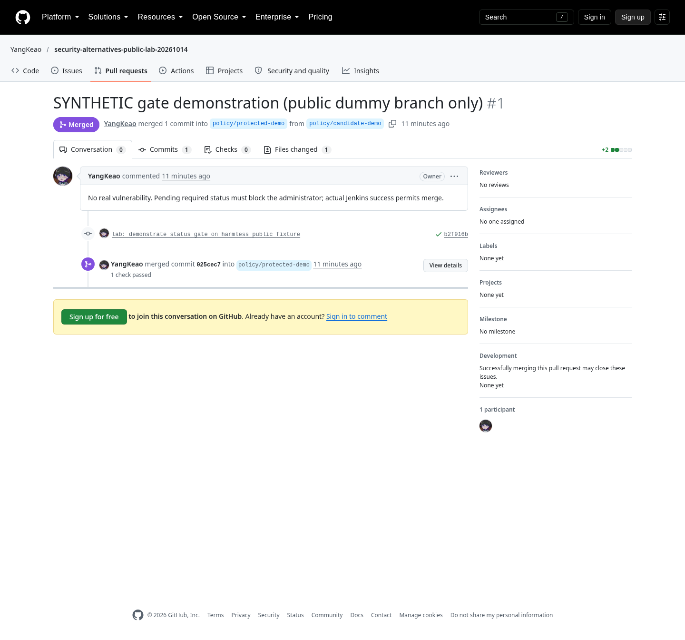

# 方法二 常设 GitHub private embargo 工作区

## 结论与体验

普通私有仓库是代码/CI/回补工作区，不是 GSA temporary fork。
本轮实际验证了 case issue、两条独立 PR、逐个 merge、任意 release base、Actions、webhook、Jenkins 和 commit status。
入口可由 GSA、受控邮件或现有 PSIRT 转接；没有 GSA 时，CVE/GHSA 和公开公告也要另设流程。

## 创建与可见性

```bash
gh repo create YangKeao/security-embargo-private-lab-20261014 \
  --private \
  --description 'Synthetic private embargo integration lab'
```

[仓库地址](https://github.com/YangKeao/security-embargo-private-lab-20261014)。
仓库由个人账号持有，本次没有修改 pingcap/tidbcloud org 的设置。
匿名浏览器访问返回 Page not found；已授权 `gh` 可以读取对象。



### private copy 不等于 public fork

GitHub 官方说明：public repo 的普通 fork 仍是 public，不能单独改成 private。
因此应建独立 private repo，再复制明确的基线 refs。
本轮普通 fork API probe 返回了当前账号已有的上游对象，没有创建新的 fork，不能把这个 probe 当作完整的跨账号 fork 权限测试。

初次导入可参考官方 bare/mirror 流程；安全工作区之后应只做明确方向的 ref 同步。
本轮实际 push 的是选定 refs：

```bash
git init -b main
git remote add public  https://github.com/YangKeao/security-alternatives-public-lab-20261014.git
git remote add private https://github.com/YangKeao/security-embargo-private-lab-20261014.git
git push private main release/8.5 release/8.1 lab-base
```

不要把已经承载私有 fix refs 的镜像，反向 `push --mirror` 到公开 upstream。
协调披露时应明确选择审阅过的 commit/tag。

## case 生命周期

本轮在私有仓库实际创建：

- issue #1：LAB-A，标签和 triage comment。
- issue #3：LAB-B，标签和 triage comment。
- issue #5：模拟重复报告，实际 close → reopen → close。
- PR #2/#4：分别 `Closes #1`、`Closes #3`，merge 后 case issue 关闭。

浏览器点击：

1. Private repo → Issues → New issue。
2. 填写 case 内容，设置 labels/assignee。
3. 用 comment 记录 triage、影响范围和发布批次。
4. 对误报/重复报告 Close issue，需要复查时 Reopen issue。
5. 代码修复用独立 PR 关联 issue。

建议 case 字段：

```json
{
  "case_id": "LAB-A",
  "coordinator": "maintainer",
  "state": "verified",
  "affected_lines": ["main", "8.5", "8.1"],
  "canonical_commit": "149592432e3e6d36f02234b7c8b454f200627268",
  "release_bundle": "lab-private-rc1",
  "advisory": "GHSA-pjwp-c2g7-4xhc"
}
```

[实际 case/PR 操作回执](../evidence/github-api-receipts.json)。

## 两条独立修复

- LAB-A：模型 tenant 边界；新增回归后，基线会失败，精确匹配修复后通过。
- LAB-B：模型 batch 上限；新增边界测试后修复。
- 两者位于不同文件，各自独立 commit/PR。

```bash
git checkout -b fix/LAB-A lab-base
# 修改 policy.py，加入 test_case_a.py
git add policy.py tests/test_case_a.py
git commit -m 'lab: fix synthetic LAB-A with regression'
git push private fix/LAB-A

gh api --method POST \
  repos/YangKeao/security-embargo-private-lab-20261014/pulls \
  --input synthetic-pr.json
```

完整脚本为 [`github_cases.py`](../scripts/github_cases.py)。
本轮使用普通 merge API，PR #2/#4 各自合并，不依赖 advisory-level merge。

## Actions 实测

私有仓库使用 Python unittest 和固定 commit 的 actions/checkout。
首次 push 后 workflow 未登记；用 Contents API 提交显式可 dispatch 的配置后，workflow 注册成功。
这只是本轮的设置过程，不推断所有仓库有相同行为。

```yaml
name: synthetic-regression
'on':
  push:
  pull_request:
  workflow_dispatch:
permissions:
  contents: read
jobs:
  test:
    runs-on: ubuntu-latest
    steps:
      - uses: actions/checkout@11d5960a326750d5838078e36cf38b85af677262
      - run: python3 -m unittest discover -s tests -v
```

```bash
gh workflow run ci.yml \
  --repo YangKeao/security-embargo-private-lab-20261014 --ref main
```

[私有运行 38506893672](https://github.com/YangKeao/security-embargo-private-lab-20261014/actions/runs/38506893672)实际 conclusion 为 success。
没有读取本轮之外的私有 Actions 日志。

## Jenkins 不是只有理论兼容

使用独立官方 Jenkins 容器，版本 2.580.1。

```bash
docker pull jenkins/jenkins:lts-jdk21
# 本轮服务只暴露为 localhost:18981。
# 生成的实验账号配置和本地数据不进入公开仓库。
```

job `synthetic-embargo` 使用参数 SHA，执行：

```sh
set -eu
rm -rf source
git clone --no-hardlinks /lab/fixture source
cd source
git checkout "$SHA"
python3 -m unittest discover -s tests -v
git archive HEAD | sha256sum | tee ../artifact-digest.txt
```

它使用本地、已授权同步的 Git 数据，测试的是指定不可变 SHA。
本轮不是在 Jenkins 中保存用户的 GitHub PAT 再任意 clone URL。

实际结果：

| build | 输入 | 结果 |
|---|---|---|
| #1 | LAB-A regression，仅加测试、未加修复 | FAILURE |
| #2 | LAB-A 修复 commit | SUCCESS |
| #3 | LAB-B 修复 commit | SUCCESS |
| #5 | GitHub 真 push webhook 对应 SHA | SUCCESS |
| 8.5 RC 的独立 build | 完整两个 case | SUCCESS |
| 8.1 RC 的独立 build | 完整两个 case，已解决冲突 | SUCCESS |





点击路径：Jenkins → synthetic-embargo → build number → Console Output / Build Artifacts。
本地访问 `http://127.0.0.1:18981`；远程检查需通过已有 SSH/VPN 转发。
运行数据在 home-gentoo 的本轮 `runtime/jenkins/home` 中保留。
生成的 labadmin 登录材料在本地 `.secrets/lab-auth.json`，没有发布到 GitHub。

## 真实 webhook 和状态回写

真实链路：

1. GitHub repo webhook 收到 push。
2. HTTPS 临时 tunnel 把请求送到实验 bridge。
3. Bridge 使用 `X-Hub-Signature-256` 验证 HMAC。
4. 拒绝未知 repo、无效 SHA 和无签名请求。
5. 授权同步这个实验 repo 的 refs。
6. 通过 Jenkins remote API 触发指定 SHA。
7. 等待真实 build result。
8. 把成功/失败写回同一 SHA 的 commit status。

未签名 POST 实测 403。
GitHub delivery 记录中 ping 为 200，push 为 202；之后出现真实 build 和对应 status。
[`github_webhook_bridge.py`](../scripts/github_webhook_bridge.py)保留了 GitHub-only 实现。
[`github-hook-deliveries.json`](../evidence/github-hook-deliveries.json)保留了服务端 delivery 回执。

```bash
gh api --method POST \
  repos/YangKeao/security-embargo-private-lab-20261014/statuses/COMMIT_SHA \
  --input synthetic-status.json
```

```json
{
  "state": "success",
  "context": "jenkins/synthetic-regression",
  "description": "Actual isolated Jenkins result",
  "target_url": "http://127.0.0.1:18981/job/synthetic-embargo/BUILD/"
}
```

浏览器：Repo Settings → Webhooks → hook → Recent Deliveries → 对照 request/response。
实验 webhook 在收尾时暂停，临时 tunnel 不作为长期服务地址。

## 强制合并门禁必须单独验证

当前个人账号 private repo 的 branch protection 请求失败：

```text
403 Upgrade to GitHub Pro or make this repository public to enable this feature.
```

所以本轮 private repo 的合并属于人工验收后的普通 merge，不能说平台强制拦住坏 CI。

为验证机制本身，另在公开无害 `policy/protected-demo` 分支配置：

- required context = `jenkins/synthetic-gate`
- strict = true
- enforce_admins = true
- review requirement = null（没有第二个 GitHub reviewer）

[公开 PR #1](https://github.com/YangKeao/security-alternatives-public-lab-20261014/pull/1)在 pending 时，即使当前管理员也收到：

```text
405 Required status check "jenkins/synthetic-gate" is pending.
```

真实 Jenkins 通过、同一 SHA 的 status 成功后，merge 成功。
自身 APPROVE review 请求也被拒绝，未伪造第二位 reviewer。



这证明 GitHub 的强制 gate 能力，但不证明当前账户的私有仓库具备这项套餐能力。
生产需检查组织套餐、required checks/approvals、管理员 bypass 和 CI 身份绑定。

## 多漏洞与两条 LTS

```bash
git checkout -b backport/combined-8.5 release/8.5
git cherry-pick 149592432e3e6d36f02234b7c8b454f200627268
git cherry-pick 3194b28e5444d8c407674c9b4e5dd57899296d78
python3 -m unittest discover -s tests -v
git push private backport/combined-8.5
```

8.1 的 A commit 实际产生 conflict：

```bash
git checkout -b backport/combined-8.1 release/8.1
git cherry-pick 149592432e3e6d36f02234b7c8b454f200627268
git diff --name-only --diff-filter=U
# 按旧分支实现解决 policy.py 的冲突。
git add policy.py
git -c core.editor=true cherry-pick --continue
git cherry-pick 3194b28e5444d8c407674c9b4e5dd57899296d78
python3 -m unittest discover -s tests -v
```

[冲突记录](../evidence/backport-conflicts.json)与两个 CI 日志保留。
PR #6/#7 的 base 分别是 `release/8.5`、`release/8.1`，都已创建且保留 open。
它们都同时包含两个 case；一个版本只审阅一个集成 RC，不代表丢掉独立 case/commit。
这里是模拟 LTS 名称和模型代码，不是 TiDB 真产品回归。

## 生产接入的实际边界

- 本轮确实测试独立 Jenkins，而非 TiDB 生产 Jenkins。
- 普通 repo 协议入口具备兼容条件；实际 TiDB App 仍需私有 repo 安装授权、event/branch 白名单和 checkout 凭据。
- 本轮用维护者凭据写 status，不证明任意写权限都无法伪造状态；生产宜绑定可信 App/check 身份。
- 这是专用实验实例的 built-in executor，没有演练生产级 agent/cache/log 权限隔离。
- 没有实测第二个 GitHub 用户或 org team 的权限回收。

## 官方资料

- [镜像复制](https://docs.github.com/en/repositories/creating-and-managing-repositories/duplicating-a-repository)
- [Fork 的可见性和网络权限](https://docs.github.com/en/pull-requests/reference/forks)
- [分支保护与套餐](https://docs.github.com/en/repositories/configuring-branches-and-merges-in-your-repository/managing-protected-branches/about-protected-branches)
- [Webhook HMAC 验证](https://docs.github.com/en/webhooks/using-webhooks/validating-webhook-deliveries)
- [Jenkins remote API](https://www.jenkins.io/doc/book/using/remote-access-api/)
