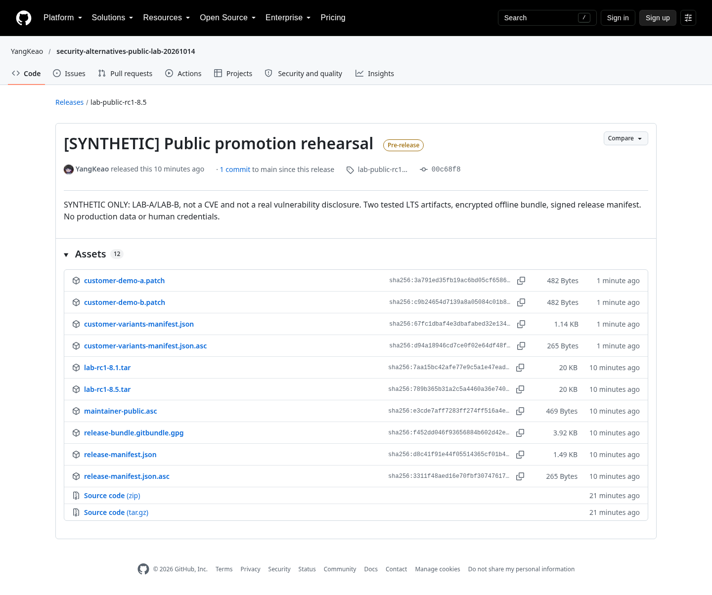

# 方法三 GitHub 私有 RC 与加密手动交付

## 结论与体验

这条路线解决“披露前给受控对象验证”和“许多客户补丁变体”问题。
GitHub 仍作为源码/case/Release 主平台；下游可以拿加密 Git bundle，在离线环境解密、验证和测试。
它不自动提供 GSA/CVE，也不自动替代正式 release policy。

本轮实际执行了加密、错误接收者拒绝、签名验证/篡改失败、两条 LTS 离线测试、私有 asset 权限和公开制品 promotion。
还从一份共同 RC 重建了两套有序客户 patch 变体。

## 输入与文件

基线 commit：`89f709484161bda5ecef0edc8715e18fb450d33c`。

| 输入 | 内容 |
|---|---|
| LAB-A canonical commit | `149592432e3e6d36f02234b7c8b454f200627268` |
| LAB-B canonical commit | `3194b28e5444d8c407674c9b4e5dd57899296d78` |
| 8.5 RC | `00c68f8015e041347ca6e955801bcb36a8039810` |
| 8.1 RC | `c11990cd14ceeb65286bc4a0cb51f5d170bbb994` |
| Git bundle | 两条 RC tag 和基线 tag 所需的 Git objects |
| 独立 patch | LAB-A.patch、LAB-B.patch |
| Release manifest | case、base、版本 SHA、source tar digest、冲突记录 |
| Manifest signature | Ed25519 演示签名 |
| Recipient encryption | 独立 downstream 演示密钥 |

全部是合成模型数据，不包含 TiDB 私有漏洞或真实客户信息。
本轮演示 keyring 只保存在本地 `.secrets/`，没有把私钥上传 GitHub。

## 操作一 固化并测试候选 refs

先完成方法二的两个 case 和 LTS。

```bash
git tag lab-rc1-8.5 00c68f8015e041347ca6e955801bcb36a8039810
git tag lab-rc1-8.1 c11990cd14ceeb65286bc4a0cb51f5d170bbb994
git push private lab-rc1-8.5 lab-rc1-8.1
```

生成离线包：

```bash
git bundle create release-bundle.gitbundle \
  lab-rc1-8.5 lab-rc1-8.1 lab-base
git bundle verify release-bundle.gitbundle

git format-patch -1 149592432e3e6d36f02234b7c8b454f200627268 --stdout > LAB-A.patch
git format-patch -1 3194b28e5444d8c407674c9b4e5dd57899296d78 --stdout > LAB-B.patch
```

生成 source tar 与 digest：

```bash
git archive --format=tar 00c68f8015e041347ca6e955801bcb36a8039810 > lab-rc1-8.5.tar
git archive --format=tar c11990cd14ceeb65286bc4a0cb51f5d170bbb994 > lab-rc1-8.1.tar
sha256sum lab-rc1-8.5.tar lab-rc1-8.1.tar release-bundle.gitbundle
```

本轮是 source tar，不是假装构建了 TiDB binary/image。

## 操作二 建立不同角色的演示密钥

维护者签名与下游解密不是同一个 keyring。

```bash
# 仅演示用；正式流程使用经过审核的真实接收者公钥。
mkdir -p GPG_MAINTAINER GPG_DOWNSTREAM
chmod 700 GPG_MAINTAINER GPG_DOWNSTREAM
gpg --homedir GPG_MAINTAINER --batch --pinentry-mode loopback \
  --passphrase '' --quick-generate-key \
  'Synthetic maintainer <maintainer@example.invalid>' ed25519 sign 7d

gpg --homedir GPG_DOWNSTREAM --batch --pinentry-mode loopback \
  --passphrase '' --quick-generate-key \
  'Synthetic downstream <downstream@example.invalid>' rsa3072 encrypt 7d
```

另建 stranger keyring，验证它不能解密。
本轮没有向这些 example.invalid 地址发送邮件。
生成代码、fingerprint 和结果见 [`manual_bundle.py`](../scripts/manual_bundle.py) / [结果](../evidence/manual-results.json)。

## 操作三 签名与加密

```bash
gpg --homedir GPG_MAINTAINER --batch --import downstream-public.asc
gpg --homedir GPG_MAINTAINER --batch --armor \
  --detach-sign release-manifest.json

gpg --homedir GPG_MAINTAINER --batch --trust-model always \
  --recipient DOWNSTREAM_FINGERPRINT \
  --output release-bundle.gitbundle.gpg \
  --encrypt release-bundle.gitbundle
```

`--trust-model always` 只是本轮本地创建且已确认 fingerprint 的演示接收者。
真实预披露分发必须有名单、密钥确认和权限审批，不能从陌生邮箱直接导入公钥就发补丁。
加密保护的是交付包，平台访问权限保护的是 private repo/Release；两者不能相互替代。

## 操作四 发布 GitHub 私有 RC

浏览器点击：

1. private repo → Releases → Draft a new release。
2. 选择正确 private RC tag/target。
3. 标记 prerelease，说明 case/version/候选用途。
4. 上传签名 manifest、加密 bundle 和版本制品。
5. 在 private repo 中发布候选，不修改 repository visibility。

本轮命令：

```bash
gh release create lab-private-rc1 \
  --repo YangKeao/security-embargo-private-lab-20261014 \
  --target main --prerelease \
  --title '[SYNTHETIC] Private RC1' \
  --notes-file release-notes.txt \
  release-bundle.gitbundle.gpg release-manifest.json \
  release-manifest.json.asc maintainer-public.asc \
  lab-rc1-8.5.tar lab-rc1-8.1.tar
```

[实际 private RC](https://github.com/YangKeao/security-embargo-private-lab-20261014/releases/tag/lab-private-rc1)。
前六个核心资产的匿名 HTTP 下载全部返回 404，授权 `gh release download` 成功。
“prerelease”不是保密开关；这里的保密来自 repo visibility 和授权。
在 public repo 上传未披露补丁的 prerelease，仍然是在公开内容。

## 操作五 下游解密并离线验证

```bash
gh release download lab-private-rc1 \
  --repo YangKeao/security-embargo-private-lab-20261014 \
  --dir private-release-download

gpg --homedir GPG_DOWNSTREAM --import maintainer-public.asc
gpg --homedir GPG_DOWNSTREAM --verify \
  release-manifest.json.asc release-manifest.json

gpg --homedir GPG_DOWNSTREAM --batch \
  --output decrypted.gitbundle \
  --decrypt release-bundle.gitbundle.gpg
sha256sum decrypted.gitbundle

git clone decrypted.gitbundle offline-checkout
cd offline-checkout
git checkout lab-rc1-8.5
python3 -m unittest discover -s tests -v
git checkout lab-rc1-8.1
python3 -m unittest discover -s tests -v
```

实际结果：

| 检查 | 实际结果 |
|---|---|
| 正确 downstream key 解密 | 成功 |
| stranger key 解密 | 非零退出，No secret key |
| 正常 manifest signature | verify 成功 |
| manifest 尾部添加一个空格再 verify | 非零退出，签名失败 |
| 解密 bundle SHA256 对照 manifest | 相同 |
| 离线 8.5 完整回归 | 通过 |
| 离线 8.1 完整回归 | 通过 |

这不是只演示 `gpg --encrypt`；它验证了接收者、签名和实际 Git/回归使用。

## 操作六 客户变体用 manifest 重建

两套 synthetic 客户变体都以同一 8.5 RC 为 base；A/B 两个安全模型修复已在 base 中。
每套变体加一份独立客户 patch，不为每个客户重新复制安全修复。

```json
{
  "variant": "demo-a",
  "base_commit": "00c68f8015e041347ca6e955801bcb36a8039810",
  "already_in_base": ["LAB-A", "LAB-B"],
  "patch_order": [
    {"file": "customer-demo-a.patch", "canonical_commit": "见实际 manifest", "sha256": "见实际 manifest"}
  ],
  "expected_tree": "见实际 manifest"
}
```

重建步骤：

```bash
git clone decrypted.gitbundle customer-build
git -C customer-build checkout -b rebuild lab-rc1-8.5
git -C customer-build am /PATH/customer-demo-a.patch
git -C customer-build rev-parse 'HEAD^{tree}'
(cd customer-build && python3 -m unittest discover -s tests -v)
```

两套变体都实际重建成功；源码 tree 与对应 canonical customer commit 的 tree 相同，完整回归通过。
它验证的是源码树一致，不声称不同构建环境能产生相同二进制。

[有序变体 manifest](../evidence/customer-variant-results.json)。
实验为了保留审计保留 `lab/customer-demo-a` / `lab/customer-demo-b` 两条 branch；它们不是生产长期维护分支建议。
生产交付以 base tag、patch order、预期 tree/制品 hash 为数据来源，人工处理真实冲突。
本轮只测试两套模型变体，没有声称已验证上百个 TiDB hotfix 的速度或兼容性。

## 操作七 协调公开日 promote 同一批制品

不是在 public repo 重新 build。

1. 从 private RC 授权下载。
2. 对照已签名 manifest 校验 SHA256。
3. 公开选择过的精确 commit/tag。
4. 把刚下载、已测试的同一批文件上传 public Release。
5. 再次下载，逐文件比较 digest。

```bash
git push public 00c68f8015e041347ca6e955801bcb36a8039810:refs/tags/lab-public-rc1-8.5
git push public c11990cd14ceeb65286bc4a0cb51f5d170bbb994:refs/tags/lab-public-rc1-8.1

gh release create lab-public-rc1-8.5 \
  --repo YangKeao/security-alternatives-public-lab-20261014 \
  --prerelease --title '[SYNTHETIC] Public promotion rehearsal' \
  --notes-file release-notes.txt PRIVATE_DOWNLOADED_FILES...
```

[公开演练 Release](https://github.com/YangKeao/security-alternatives-public-lab-20261014/releases/tag/lab-public-rc1-8.5)。
六个核心文件都在 private 授权下载和 public 再下载之间逐 byte/hash 相同。
另外追加两份 customer patch、变体 manifest 和 signature，保留独立变体证据。



这里公开的是合成示例；真实漏洞的公开日期、CVE、下游承诺和公告仍要由有权负责人协调。
本轮没有 publish 任何 advisory。

## 体验优点与成本

优点：不要求接收者使用相同 CI 平台；能离线测试；可固定候选内容；有利于将客户版本从长期 branch 转成 patch 数据。
成本：密钥/接收者治理、包和版本矩阵、确认回执、冲突解决和公开日同步仍需协调。
若只发送 patch 文件，没有 case/version/签名/digest/验收记录，不能算完整的预披露发布流程。

## 官方资料

- [GitHub Release](https://docs.github.com/en/repositories/releasing-projects-on-github/managing-releases-in-a-repository)
- [Git bundle](https://git-scm.com/docs/git-bundle)
- [Git format-patch](https://git-scm.com/docs/git-format-patch)
- [Git am](https://git-scm.com/docs/git-am)
